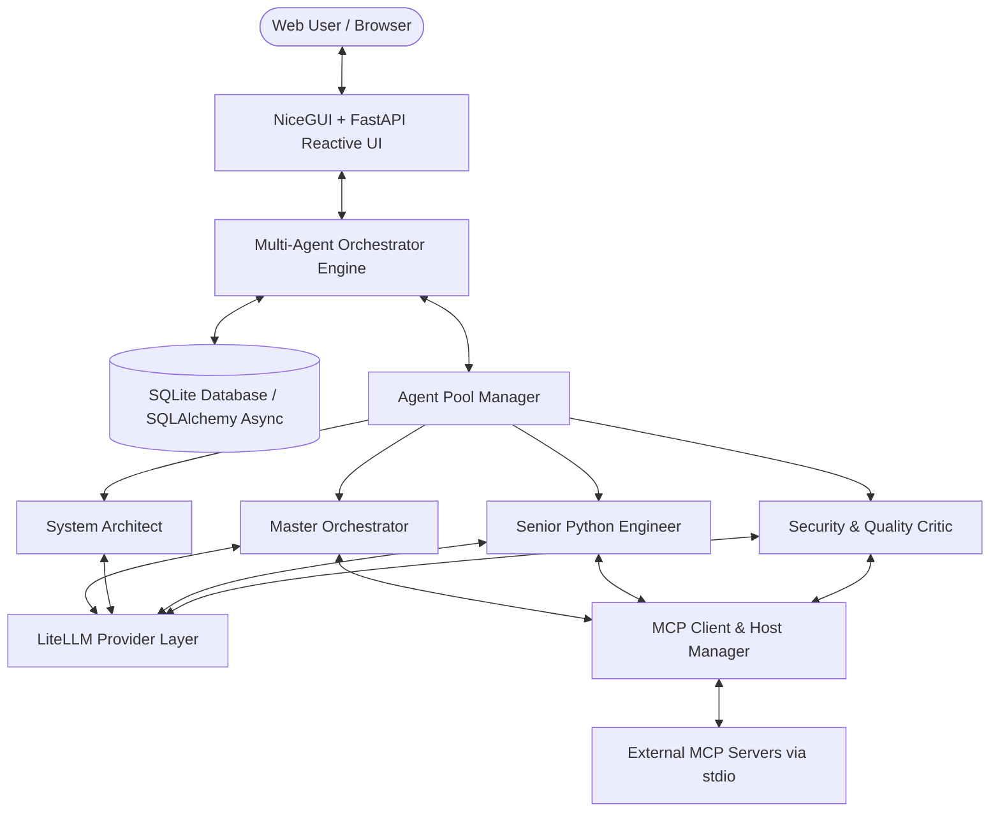

# 🤖 MADO — Multi-Agent Debate & Orchestration Platform

`v2.1` · `LGPL-3.0-or-later` · `Python 3.11+`

> **MCP 도구를 활용하는 반응형 멀티 에이전트 협업 & 토론 웹 애플리케이션**  
> Dynamic Agent Profiling via `conf.json`, MCP Tool Integration, Multi-Model LLM Abstraction (LiteLLM), StateGraph Orchestration, and NiceGUI + FastAPI Reactive Web Interface.

---

## 🌟 주요 특징 (Key Features)

1. **`conf.json` 기반 동적 에이전트 프로파일링**:
   - `conf.json` 파일로부터 에이전트 풀(Agent Pool)과 MCP 서버를 동적으로 등록합니다.
   - `${OPENAI_API_KEY}`, `${CORP_LLM_TOKEN}` 등 환경 변수 치환 및 웹 UI 상에서의 에이전트 실시간 추가·편집을 지원합니다.
2. **Model Context Protocol (MCP) 내장 호스트 & 도구 연동**:
   - Filesystem, Memory(세션별 지식 그래프), Git, Python 코드 실행 샌드박스 MCP 서버와 JSON-RPC stdio 통신을 수행합니다.
   - 공식 레퍼런스 서버와 자체 샌드박스를 번들로 동봉하여 폐쇄망에서도 즉시 도구를 활용할 수 있습니다.
   - **도구 호출 예산 및 컨텍스트 포화 안전가드**: 한계 도달 시 임의로 발언을 버리지 않고 사용자에게 상한 확장 또는 마무리를 확인합니다.
3. **다양한 LLM 프로바이더 추상화 (LiteLLM)**:
   - OpenAI, Anthropic, Google Gemini, Ollama, vLLM, LM Studio 등 사내외 다양한 엔드포인트를 통합 지원합니다.
   - 전역 `llm` 설정 상속, Sequential Thinking(단계적 사고 3종 모드), 개별 모델 장애 시 전역 모델 폴백(`llm.fallback`)을 제공합니다.
4. **브라우저와 독립된 백그라운드 토론 오케스트레이션**:
   - 페이지 새로고침이나 탭 이동에도 백그라운드 토론이 중단되지 않으며, 복귀 시 실시간 스트리밍으로 즉시 이어집니다.
   - **6가지 토론 전략**: 순차 토론(`sequential_debate`), 디베이트(`adversarial_debate`), 오케스트레이터 지명(`orchestrator_led`), 병렬 지시(`parallel_dispatch`), 그래프 토론(`graph_debate`), 적응형 그래프(`adaptive_graph`).
   - 결정 장부 기반 조기 합의 종료, 계획 승인 카드(`plan_approval`), 에이전트의 사용자 질문(Ask User) 기능을 제공합니다.
5. **세션별 페르소나 & 자기완결적 아키텍처**:
   - 첫 사용자 메시지 전송 시 전체 에이전트 구성과 페르소나가 DB에 불변 스냅샷으로 영구 고정됩니다.
   - 이후 `conf.json`이 변경되거나 에이전트가 삭제되어도 기존 대화 세션은 당시의 구성을 온전히 유지하여 독립적으로 동작합니다.
6. **반응형 모던 Web GUI (FastAPI + NiceGUI)**:
   - **좌측 사이드바**: 세션 히스토리, 검색, 대화 마크다운 내보내기, 승인 대기 배지 알림.
   - **상단 제어 패널**: 참여 에이전트 토글, 라운드 슬라이더, 전략 변경, 모델 연결 상태 헬스체크 창.
   - **메인 피드 & 입력창**: 카드형 타임라인, 접이식 MCP 로그, `@` 작업 공간 파일/전문가 멘션 및 원클릭 파일 업로드.
   - **우측 산출물 뷰어**: 최종 종합 보고서(Markdown), 소스 코드(Code, Unified/Split Diff 비교), Mermaid 아키텍처 다이어그램 탭.
7. **작업 공간 버전 관리, 세션 분기(Fork) 및 단일 발언 관리**:
   - 턴별 Git 스냅샷 자동 생성으로 작업 공간 변경점(Diff) 확인 및 원클릭 되돌리기(Rollback)를 지원합니다.
   - 특정 시점의 대화를 새 세션으로 분기하여 `/compare` 페이지에서 나란히 비교 및 평가할 수 있습니다.
   - 완료된 턴의 단일 발언 단독 재실행, 문장 드래그 인라인 코멘트, 결정 장부 직접 편집을 지원합니다.
8. **스킬 & 플러그인 확장 생태계**:
   - `skills/<이름>/SKILL.md` 디렉터리 배치로 에이전트에게 동적 작업 지침 및 실행 스크립트를 부여합니다.
   - `strategies/`, `host_tools/` 플러그인을 통해 코어 수정 없이 신규 토론 전략과 호스트 도구를 자유롭게 확장할 수 있습니다.
9. **체험 서버(`/trial`) 및 비엔지니어 화면(`/trial/easy`)**:
   - 사내 공용 서버에서 방문자 계정(이름/PIN)으로 템플릿 기반 토론을 체험할 수 있는 다중 사용자 모드를 제공합니다.
   - 비엔지니어를 위해 생각(Thought) → 행동(Action) → 관찰(Observation) 루프 시각화 및 대화형 에이전트 빌더를 제공합니다.
10. **완전한 오프라인 폐쇄망(Air-Gapped) 배포 지원**:
    - 인터넷이 단절된 사내망에서도 구동되도록 포터블 런타임 번들링(`package_offline.py`) 및 경량 소스 갱신 패키징(`package_source.py`)을 완비했습니다.

---

## 🏗️ 시스템 아키텍처 (Architecture)



---

## 🚀 빠른 시작 (Quick Start)

### 1. 의존성 설치
```bash
pip install -r requirements.txt
```

### 2. MCP 서버 준비 (최초 1회, 인터넷 필요)
```bash
python setup_mcp.py
```
- `./workspace` 디렉터리 생성 및 git 저장소를 초기화합니다.
- `./mcp_node`에 Node MCP 서버(filesystem, memory, sequential-thinking)를 설치합니다.
- `./mcp_sandbox`에 [AirgappedPySandbox](https://github.com/HaJaehee/AirgappedPySandbox) 저장소를 체크아웃합니다.

### 3. 설정 파일 준비
```bash
cp conf.example.json conf.json
cp .env.example .env
```
`.env` 파일에 사내 LLM 엔드포인트 또는 API 키를 입력합니다:
```dotenv
LLM_API_BASE=http://localhost:1234/v1     # 사내 게이트웨이 / vLLM / LM Studio / Ollama
LLM_MODEL=openai/qwen2.5-coder-32b        # 모델명
LLM_API_KEY=                              # 로컬 모델인 경우 비워두십시오
```

### 4. 애플리케이션 실행
```bash
python -m app.main
```
브라우저에서 `http://127.0.0.1:8000`으로 접속합니다 (포트 및 호스트는 `conf.json` 또는 `.env`에서 변경 가능).

> 💡 **원격 PC 접속 및 다중 사용자 모드**:
> 다른 PC에서 접속하려면 `APP_HOST=0.0.0.0`으로 기동하고 관리자 인증 토큰(`.env`의 `MADO_ACCESS_TOKEN`) 또는 다중 사용자 체험 모드(`trial.enabled`)를 활용합니다. 상세 가이드는 [conf.json 설정 가이드](docs/user_manual/02-getting-started/02-configuration.md#원격-접속-토큰-다른-pc-에서-접근-시) 및 [체험 서버 매뉴얼](docs/user_manual/04-workflows/06-trial-and-easy-mode.md)을 참조하십시오.

---

## 📁 프로젝트 구조 (Directory Structure)

```text
MultiAgentDebateOrchestration/
├── conf.example.json         # 설정 템플릿 (저장소에 커밋되는 원본)
├── setup_mcp.py              # 개발 PC용 MCP 서버 일괄 설치 스크립트
├── package_offline.py        # 폐쇄망 배포 번들 패키징 스크립트 (런타임 + 도구 동봉)
├── package_source.py         # 소스·설정 패키징 스크립트 (경량 갱신 반입용)
├── requirements.txt          # 파이썬 의존성 패키지 목록
├── docs/                     # 사용 설명서 (마크다운 원본 및 HTML 렌더러)
│   ├── user_manual/          # 사용자 매뉴얼 (01-overview ~ 05-reference)
│   └── render_user_manual.py # 독립형 정적 HTML 렌더러
├── skills/                   # 스킬 디렉터리 (<이름>/SKILL.md 작업 지침)
├── strategies/, host_tools/  # 사용자 정의 토론 전략 및 호스트 도구 플러그인
├── trial_templates/          # 다중 사용자 체험 모드 시나리오 템플릿
├── app/                      # 애플리케이션 메인 소스 코드
│   ├── main.py               # FastAPI 서버 조립 및 lifespan 진입점
│   ├── config/               # Pydantic 설정 모델, 환경변수 치환, conf.json 로더/편집기
│   ├── database/             # SQLAlchemy 비동기 ORM 모델 및 세션 관리
│   ├── mcp/                  # MCP 호스트, stdio 클라이언트, 도구 보안 정책 및 런타임 풀
│   ├── agents/               # LiteLLM 호출기, 도구 루프, 페르소나, 스킬 엔진
│   ├── orchestration/        # 토론 엔진, 6가지 토론 전략, 계획 승인 및 상태 관리
│   ├── trial/, easy/         # 다중 사용자 체험 모드 및 비엔지니어 전용 화면
│   └── ui/                   # NiceGUI 기반 반응형 웹 UI 컴포넌트
├── mcp_servers/              # 자체 내장 MCP 서버 (memory_scoped, anythingllm_kb)
└── tests/                    # 자동화 테스트 스위트 (2,100+ 테스트)
```

상세한 모듈별 구현 사양 및 전체 디렉터리 배치는 [프로젝트 구조 레퍼런스](docs/user_manual/05-reference/02-project-layout.md)를 참고하십시오.

---

## 🧪 테스트 실행 (Running Tests)

```bash
pytest -v tests/
```

---

## 📚 상세 문서 (Documentation)

MADO의 세부 아키텍처, 설정법, 핵심 기술 원리 및 워크플로우는 **`docs/user_manual`**에 체계적으로 수록되어 있습니다.

| 섹션 | 다루는 주요 내용 | 바로가기 |
| :--- | :--- | :--- |
| **01. 개요** | 시스템 미션, 기술 스택 선정 이유, 레이어 아키텍처 | [시스템 개요](docs/user_manual/01-overview/README.md) |
| **02. 시작하기** | 상세 설치 절차, `conf.json` 설정 전체 가이드, 원격 토큰 보안 | [시작하기](docs/user_manual/02-getting-started/README.md) · [설정 가이드](docs/user_manual/02-getting-started/02-configuration.md) |
| **03. 핵심 기술** | LLM 통합 루프, 도구 보안(허용/묻기/거부), 지연 로딩, 스킬, 플러그인 | [핵심 기술 개관](docs/user_manual/03-core/README.md) |
| **04. 워크플로우** | 토론 턴 생애주기, 세션 스냅샷 잠금, 로스터 편집, 폐쇄망 배포, 체험 모드 | [워크플로우 개관](docs/user_manual/04-workflows/README.md) |
| **05. 레퍼런스** | REST API 규격, 프로젝트 상세 레이아웃, 자동화 테스트 스위트 | [레퍼런스 개관](docs/user_manual/05-reference/README.md) · [HTTP API](docs/user_manual/05-reference/01-http-api.md) |

### 오프라인 HTML 매뉴얼 보기
외부 인터넷이 없는 폐쇄망에서도 브라우저로 열람할 수 있는 독립형 정적 HTML 사이트를 생성합니다:
```bash
python docs/render_user_manual.py
```
`docs/user_manual_html/index.html` 파일이 생성되며, 파이썬 표준 라이브러리만으로 동작합니다.

---

## ℹ️ 정보 (About)

| 항목 | 값 |
|------|-----|
| **Author** | Ha, Jaehee |
| **Email** | lovesm135@naver.com |
| **License** | LGPL-3.0-or-later ([LICENSE.md](LICENSE.md)) |

버전 정보는 [`app/about.py`](app/about.py) 한 곳에서 단일 관리되며, 헬스체크 API를 통해서도 확인할 수 있습니다:

```bash
curl -s localhost:8000/api/health
```
