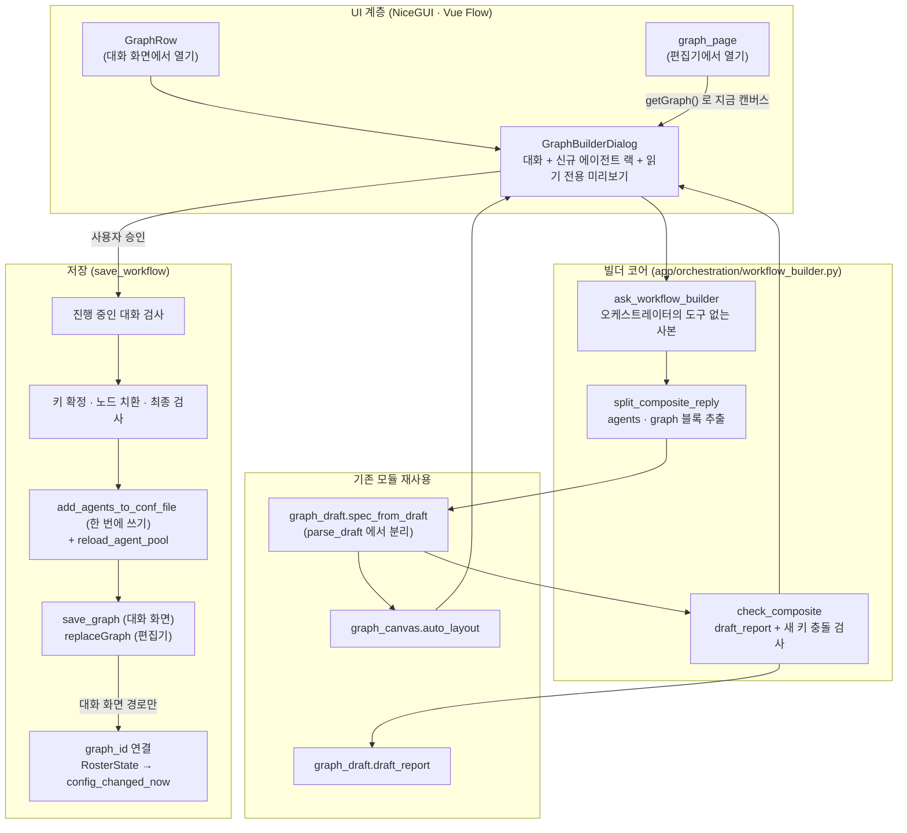

# AI 대화형 커스텀 에이전트 그래프 및 페르소나 생성 기능 개발 계획

> 상태: 구현 완료 (2026-11-04) · 아키텍처 결정 기록: [ADR-050](../lectures/05-adr/ADR-050-build-workflows-by-conversation.md). 초기 초안 대비 변경 사항은 [부록](#부록-검토-반영-내역-2026-11-04)을 참조하세요.

## 1. 개요 및 배경 (Overview & Background)

### 1.1 배경
본 플랫폼은 다자간 에이전트 토론 및 협업을 조율하는 멀티 에이전트 오케스트레이션 시스템입니다. 이 기능에 필요한 부품은 대부분 이미 따로따로 구현되어 있습니다.

1. **대화형 에이전트 빌더** (`app/agents/draft.py`, `app/ui/components/agent_builder_chat.py`, `app/ui/components/roster/builder_dialog.py`)
   - 일반 사용자가 AI 도우미와 대화하며 에이전트의 역할, 업무 지시서(시스템 프롬프트), MCP 도구, 스킬을 정하고 `conf.json`에 저장합니다.
   - `BuilderChat.send`가 버블·스트리밍·연결 실패 처리를 맡고, 응답 끝의 ```` ```agent {json}``` ```` 블록을 읽어 설계도에 반영합니다. 화면에서 고친 값은 다음 말에 `[지금 설계도]`로 붙여 도우미에게 돌려줍니다.
   - 저장(`save_owner_agent`)은 어느 대화든 진행 중이면 거부합니다. 에이전트 풀을 프로세스 전체가 하나만 쓰기 때문입니다.
2. **그래프 토론과 편집기** (`app/orchestration/graph.py`, `app/graph_store.py`, `app/ui/graph_page.py`, `app/ui/components/graph_canvas.py`, ADR-021)
   - 병렬 분기, 합류, 판정 루프를 그래프 데이터로 표현하고 실행합니다. `validate_graph`가 저장할 때와 턴을 시작할 때 같은 검사를 합니다.
   - `graph_canvas.auto_layout`이 좌표가 없는 노드를 자동으로 배치하고, `save_graph`는 임시 파일에 쓴 뒤 바꿔 끼웁니다.
3. **적응형 그래프** (`app/orchestration/graph_draft.py`, `app/orchestration/phases/graph_drafting.py`, ADR-034)
   - 오케스트레이터가 턴마다 실행 그래프를 그립니다. `draft_prompt`(노드·선 규격), `parse_draft`(시작·끝 노드 삽입, 선 id·핀 보정, 취합 노드 `wait=all`), `draft_report`(검증 + 노드 12개·호출 40회 상한)와 1회 재시도가 이미 있습니다.

### 1.2 개발 목적
비엔지니어 사용자가 복합 워크플로(예: *"시장 조사와 보안 감사를 병렬로 돌리고, 취합해 검토한 뒤 결함이 있으면 재작업하는 파이프라인"*)를 캔버스에서 노드와 핀으로 직접 조립하기는 여전히 어렵습니다.
이 기능은 **사용자가 원하는 업무 흐름을 말로 설명하면, 도우미가 대화하며 그래프 구조를 설계하고, 풀에 맞는 전문가가 없으면 새 에이전트 페르소나까지 함께 만들어 한 번에 등록·저장하는 대화형 워크플로 저작 환경**을 만드는 것이 목적입니다.

### 1.3 범위
- **포함**
  - 대화 화면에서 새 그래프 만들기
  - 편집기에서 지금 그래프 고쳐 쓰기
  - 그래프에 필요한 새 에이전트 만들기
- **제외**
  - **기존 에이전트 설정 수정** (도구 추가 등). 요청이 오면 도우미는 설계도를 바꾸지 않고 로스터에서 고치도록 안내합니다. 기존 블록을 고치는 일은 로스터 편집 규칙과 잠금이 다루는 영역이라, 경로를 하나 더 열면 서로 덮어쓸 위험이 생깁니다.
  - **`/graphs` 목록 페이지**. 지금은 없으며(`/graphs/{graph_id}` 편집기만 있음), 필요하면 별도 과제로 다룹니다.
  - **체험 방문자**. 주인 화면에서만 엽니다. `conf.json`과 그래프 파일은 서버 전체가 함께 쓰고, 방문자는 문지기(`app/security.py`)가 주인 화면을 막습니다.

---

## 2. 전체 시스템 아키텍처 및 데이터 흐름



---

## 3. 대화 프로토콜 및 복합 데이터 계약 (Composite Draft)

새 모듈은 `app/orchestration/workflow_builder.py`입니다. 계층 규칙(`tests/test_layering.py`)상 `app.agents`는 상위 계층인 `app.orchestration`(그래프 명세·`graph_draft`·`format_roster`)을 참조할 수 없으므로 `orchestration` 패키지에 배치합니다. 기존 `app/orchestration/graph_draft.py` 및 내부의 `GraphDraft` 클래스와 혼동되지 않도록 `graph_draft_builder` 같은 이름은 사용하지 않습니다.

### 3.1 복합 설계도 데이터 모델

```python
class CompositeDraft(BaseModel):
    """대화 중에 쌓이고 고쳐지는 설계도. 화면과 도우미가 같은 값을 봅니다."""
    new_agents: List[AgentDraft] = Field(default_factory=list)
    # 사용자가 랙에서 뺀 새 에이전트 키. 도우미가 다시 만들어 넣지 않도록 함께 알립니다.
    removed_agents: List[str] = Field(default_factory=list)
    # 도우미가 보낸 모양 그대로의 그래프 (`draft_view` 형식). 읽지 못한 응답이 와도 마지막으로 읽은 값을 지킵니다.
    graph_data: Optional[Dict[str, Any]] = None
    # `graph_data` 를 `spec_from_draft` 로 읽은 결과. id 는 임시 값이고 저장할 때 정합니다.
    graph: Optional[GraphSpec] = None
    errors: List[str] = Field(default_factory=list)
    warnings: List[str] = Field(default_factory=list)
    worst_case_calls: int = 0
    # 편집기에서 열었을 때 고쳐 쓰는 그래프의 id. 대화 화면에서 새로 만들면 빈 값입니다.
    base_graph_id: str = ""
```

### 3.2 도우미 시스템 프롬프트 (`workflow_builder_prompt`)
- **역할**: 워크플로 설계자 겸 에이전트 컨설턴트입니다. 대화 상대는 비개발자이므로 기존 빌더의 대화 방식(한 번에 질문 두 개까지, 두세 번 안에 초안 완성)을 그대로 따릅니다.
- **도우미 에이전트**: `builder_agent(pool, prompt)`와 같이 오케스트레이터의 연결 설정을 쓰는 도구 없는 사본입니다.
- **주입 컨텍스트**
  1. **쓸 수 있는 전문가**: 켜진 풀의 전문가(오케스트레이터 제외)의 키·이름·역할·도구입니다. `format_roster(..., with_keys=True)`를 재사용합니다.
  2. **이미 쓰인 키**: `conf.json`의 모든 에이전트 키(꺼진 것 포함)와 `orchestrator`입니다. 새 에이전트는 이 키를 쓸 수 없습니다.
  3. **도구·스킬 카탈로그와 카드 색·아이콘 허용값**: `builder_prompt`와 같은 목록입니다.
  4. **노드·선 규격**: `graph_draft.draft_prompt`의 노드 종류·선 설명을 상수로 떼어 두 프롬프트가 같은 문장을 씁니다. 규격이 바뀔 때 한 곳만 고치면 됩니다.
  5. **기준 그래프** (편집기에서 열었을 때): 지금 캔버스를 `draft_view` 모양으로 싣습니다.
- **설계 규칙**
  - 되돌아가는 선은 반드시 `gate`를 거칩니다. 루프는 **고칠 사람이 있을 때만** 만듭니다(검토 → 판정 → 수정 → 검토). 같은 검토자에게 되돌리기만 하는 루프는 만들지 않습니다.
  - 루프 안의 노드에는 `max_visits`(2~3)를 적습니다. 그래야 세션의 최대 라운드와 상관없이 비용이 정해집니다.
  - 풀에 맞는 전문가가 없을 때만 새 에이전트를 만들고, 있으면 기존 키를 씁니다.
  - agent 노드의 `instruction`은 권장 사항입니다. `validate_graph`는 요구하지 않으므로 검증 오류로 다루지 않습니다.
  - 시작·최종 합성을 빼고 노드는 12개까지, 최악의 경우 호출은 한 턴에 40회까지입니다.
  - 기존 에이전트를 고쳐 달라는 요청에는 설계도를 바꾸지 않고 로스터에서 고치도록 안내합니다.
- 사용자 메시지 끝의 `[지금 설계도]`는 사용자가 화면에서 고친 최신 값이므로 가장 먼저 반영합니다. 기존 빌더와 같은 표지를 씁니다.

### 3.3 응답 포맷 (Multi-Block Protocol)
- 도우미는 설명 문장 뒤에 블록을 최대 두 개 붙입니다. ```` ```agents ````(새 에이전트 배열)와 ```` ```graph ````(그래프 객체)입니다.
- 바뀐 것이 없는 블록은 생략해도 됩니다. 생략은 "그대로"이고, 빈 배열 `[]`은 "새 에이전트 없음"입니다.
- 파서는 너그럽게 받습니다. `agent` 태그도 받고, 배열 대신 객체 하나가 와도 받습니다. `json` 태그는 어느 블록인지 알 수 없으므로 받지 않습니다.
- `graph` 블록은 `draft_prompt`의 답 모양을 따릅니다.
  - 시작·끝 노드는 적지 않고, 선에서 `start`, `end` id만 씁니다.
  - 선은 `from`/`to`에 `port`(판정에서 나가는 선만)와 `carry`를 붙입니다.
  - 이 모양이어야 `spec_from_draft`의 보정(시작·끝 삽입, 선 id·핀, 취합 노드 `wait=all`)을 그대로 받습니다.

아래 예시는 풀에 `coder`(Senior Python Engineer)가 있다고 가정합니다.

````markdown
컨트랙트 보안 점검 전문가를 새로 만들고, 치명적인 취약점이 남아 있으면 Senior Python Engineer 가 고친 뒤 다시 점검하는 흐름으로 그렸습니다.

```agents
[
  {
    "key": "contract_auditor",
    "name": "컨트랙트 보안관",
    "role": "스마트 컨트랙트 정적 분석 및 보안 취약점 점검",
    "system_prompt": "당신은 Web3 보안 전문가입니다. 재진입 공격(Reentrancy) 등 취약점을 점검하고, 발견한 문제마다 위치와 고칠 방법을 적습니다.",
    "allowed_mcp_servers": ["filesystem"],
    "allowed_skills": [],
    "card_color": "#e64a19",
    "icon": "security"
  }
]
```

```graph
{
  "name": "스마트 컨트랙트 보안 감사",
  "nodes": [
    { "id": "audit", "type": "agent", "agent": "contract_auditor", "label": "보안 점검",
      "instruction": "코드의 취약점을 점검하고 심각도를 매기세요.", "max_visits": 2 },
    { "id": "check", "type": "gate", "question": "치명적인 취약점이 남아 있습니까?", "max_visits": 2 },
    { "id": "fix", "type": "agent", "agent": "coder", "label": "취약점 수정",
      "instruction": "지적된 취약점을 고치세요.", "max_visits": 2 }
  ],
  "edges": [
    { "from": "start", "to": "audit" },
    { "from": "audit", "to": "check" },
    { "from": "check", "to": "fix", "port": "yes" },
    { "from": "check", "to": "end", "port": "no" },
    { "from": "fix", "to": "audit", "carry": "refs" }
  ]
}
```
````

최악의 경우 호출 수는 점검 2 + 판정 2 + 수정 2 + 계획 1 + 최종 합성 1 = 8회입니다. 판정 노드를 빼면 순환이 남지 않으므로 루프 검사를 통과합니다.

### 3.4 응답 파싱 및 양방향 컨텍스트 동기화
- **`split_composite_reply(content) -> CompositeReply`** (`text`, `agents`, `graph`, `broken`)
  - 추론 흔적을 걷어낸 뒤(`strip_reasoning_trace`) 펜스 블록을 태그별로 **먼저** 잘라냅니다. 태그마다 마지막 블록만 씁니다.
  - 블록 안의 JSON을 읽지 못하면 그 항목은 `None`("이번 응답에 없음")으로 두어 이전 값을 지키고, 자가 교정(4.2)을 요청합니다.
  - 기존 파서는 그대로 쓸 수 없습니다.
    - `draft.py`의 `_BLOCK_RE`는 `{...}` 객체만 잡고, `json` 태그도 agent 블록으로 잡습니다.
    - `parse_draft`의 `\{.*\}` 탐욕 검색은 블록이 둘이면 첫 `{`부터 마지막 `}`까지 잡아 JSON이 깨집니다.
  - 그래서 `parse_draft`를 "텍스트 → dict"와 "dict → GraphSpec"(`spec_from_draft(data, graph_id, max_visits)`) 두 단계로 나눕니다. 빌더는 뒤 단계만 쓰고, 적응형 그래프는 두 단계를 이어서 써서 동작이 그대로입니다.
- **스트리밍 가림**: `streaming_text`를 일반화해 `agent`·`agents`·`graph` 블록 중 처음 나오는 것부터 화면에서 가립니다. 지금은 `graph` 블록이 스트리밍 중에 그대로 보입니다.
- **병합**
  - 새 에이전트는 키를 기준으로 하나씩 `merge_draft`하고, `sanitize_draft`로 허용되지 않는 도구·스킬·색·아이콘을 걸러냅니다.
  - 사용자가 랙에서 뺀 키는 `removed_agents`로 도우미에게 알려, 같은 에이전트를 다시 넣지 않게 합니다.
- **`with_composite_draft(user_text, current) -> str`**: 새 에이전트, `draft_view` 모양의 그래프, 뺀 키를 `[지금 설계도]` 블록으로 붙입니다.
- **대화 기록 크기**
  - 설계도는 **가장 최근 사용자 메시지에만** 붙입니다. 기록에는 사용자 원문만 남기고, 도우미 응답의 블록은 "(설계도 블록 — 지금 설계도 참조)"로 줄여 저장합니다. 최신 상태는 늘 `[지금 설계도]` 한 벌입니다.
  - 기존 에이전트 빌더는 매 메시지에 설계도를 붙이지만 크기가 작아 문제가 없었습니다. 그래프와 여러 에이전트는 수 KB라, 턴마다 사용자 쪽과 도우미 쪽에 두 벌씩 쌓이면 `max_context_window`에 금방 닿습니다.

---

## 4. 무결성 사전 검증 및 자동 레이아웃

### 4.1 사전 검증 (`check_composite`)
- **기반**: `graph_draft.draft_report(spec, candidates, max_rounds)`를 그대로 씁니다. `validate_graph`에 전문가 0명 검사, 노드 12개, 최악 호출 40회 상한이 더해져 있습니다. `graph.py`에 새 검증 함수를 만들지 않습니다.
  - `candidates` = 켜진 풀의 전문가 키 + 새 에이전트 키
  - 시작 노드 유일성, 시작에서 최종 합성으로 가는 길, 판정 없는 순환 금지(ADR-021의 "판정을 빼면 순환이 없어야 한다"), 핀 이름(`in`·`out`·`yes`·`no`)은 `validate_graph`가 검사합니다.
  - 꺼진 에이전트를 노드에 쓰면 지금은 "없습니다"로 나옵니다. "꺼져 있습니다"로 맞추려면 `draft_report`가 `{키: 켜짐}`을 받도록 넓힙니다(선택).
- **빌더 전용 추가 검사**
  - 새 에이전트 키가 이미 쓰인 키(`conf.json` 전체, 꺼진 것과 `orchestrator` 포함)와 겹치면 오류입니다: "새 에이전트 키 coder 는 이미 있습니다 — 다른 키를 쓰거나 기존 에이전트를 쓰세요". 겹친 채로 두면 문제가 생깁니다. 저장할 때 `agent_key_for`가 키를 `coder_2`로 바꾸는데 노드는 여전히 기존 `coder`를 가리키므로, 검증을 통과한 뒤 **오류 없이 다른 에이전트가 발언**합니다.
  - 키 형식(`^[a-z][a-z0-9_]{0,39}$`)과 새 에이전트끼리의 중복도 검사합니다.
  - 어느 노드에도 쓰이지 않은 새 에이전트는 경고합니다: "저장하면 쓰이지 않는 에이전트가 등록됩니다".
- **비용 계산 기준**: 대화 화면에서 열면 그 대화의 최대 라운드로, 편집기에서 열면 편집기와 같은 `PREVIEW_MAX_VISITS`(3)로 상한 없는 노드를 셉니다. 루프 노드에는 `max_visits`를 적게 하므로 대부분 실제 실행과 같습니다. 화면에는 "최대 N회 호출 (상한 없는 노드는 M회로 계산)"으로 보여 줍니다.

### 4.2 자가 교정 (Self-Correction Loop)
- **조건**: 오류가 **방금 받은 도우미 응답**에서 생겼을 때만 자동으로 다시 쓰게 합니다(블록을 읽지 못한 경우 포함). 사용자가 랙에서 고쳐서 생긴 오류는 화면에만 보여 줍니다. 자동으로 다시 쓰게 하면 사용자 수정을 덮어씁니다.
- **횟수**: 사용자 메시지 하나에 자동 재작성 1회입니다. `graph_draft.DRAFT_ATTEMPTS`(2회 시도)와 같은 규칙입니다.
- **기록**: 재작성 요청(`[앞선 설계의 문제]` + 오류 목록)과 틀린 응답은 대화 기록에 남기지 않고, 고쳐진 응답이 그 자리를 대신합니다. 화면에는 "설계도에 문제가 있어 한 번 고쳐 받았습니다" 한 줄만 보여 줍니다. 재작성도 실패하면 오류를 보여 주고 마지막으로 통과한 설계도를 유지합니다.

### 4.3 자동 배치
- **새로 만들지 않습니다.** `graph_canvas.auto_layout`이 이미 `start`에서 BFS로 열을, 같은 열 안의 순서로 행을 정하고(`LAYOUT_DX` 230, `LAYOUT_DY` 130), `spec_to_canvas`가 좌표 없는 노드에 자동으로 적용합니다.
- **개선**: 지금은 최단 거리로 열을 정합니다. 그래서 길이가 다른 갈래가 취합 노드로 모이면, 취합 노드가 긴 갈래의 마지막 노드와 같은 열에 놓여 선이 세로로 꺾입니다(`start→A→B→M`, `start→C→M`이면 B와 M이 둘 다 2열).
  - 되돌림 선(`back_edges`)을 뺀 순방향 그래프에서 **최장 경로**로 열을 정합니다.
  - 좌표가 있는 노드(편집기에서 사람이 옮긴 자리)는 그대로 둡니다.
  - 같은 함수를 쓰므로 손으로 쓴 JSON과 카드 순서 그래프에도 똑같이 적용됩니다.

---

## 5. UI/UX 화면 구성 상세 (NiceGUI)

### 5.1 컴포넌트 구조 (`app/ui/components/graph_builder_dialog.py`)
- 대화 루프는 `BuilderChat.send`(버블, 스트리밍, 연결 실패 처리)를 재사용합니다. 지금은 `ask_builder`·`split_reply`·`merge_draft`를 직접 부르므로, 요청·분해·병합을 메서드로 떼어 하위 클래스가 바꿀 수 있게 합니다. 기존 두 빌더(쉬운 화면, '에이전트 추가' 창)의 동작은 그대로입니다.
- 다이얼로그는 `w-[1100px] max-w-full h-[80vh]`이고, 왼쪽 40%는 대화, 오른쪽 60%는 랙과 미리보기입니다.

```
┌──────────────────────────────────────────────────────────────────────────────────┐
│ 🗺️ 대화로 워크플로 만들기                                                    [X] │
├─────────────────────────────┬────────────────────────────────────────────────────┤
│ [대화 (40%)]                │ [설계 현황 (60%)]                                  │
│                             │                                                    │
│ 🤖 도우미                   │ 📦 새로 만들 에이전트 (1명)                        │
│ 보안관을 새로 만들고, 취약  │ ┌────────────────────────────────────────────────┐ │
│ 점이 남으면 엔지니어가 고친 │ │ 🛡️ 컨트랙트 보안관 (contract_auditor)          │ │
│ 뒤 다시 점검하게 했습니다.  │ │ 역할: 취약점 점검 · 도구: filesystem            │ │
│                             │ │                              [고치기] [빼기]   │ │
│ 👤 사용자                   │ └────────────────────────────────────────────────┘ │
│ 수정은 두 번까지만 해 줘.   │ 📊 미리보기 (읽기 전용)                             │
│                             │                                                    │
│ 예시: [2인 교차 검토]       │  [시작] ─▶ [보안 점검] ─▶ <취약점 남음?>            │
│       [병렬 조사 후 취합]   │               ▲               │예        │아니오    │
│                             │               └── [취약점 수정] ◀┘        └▶ [최종 합성] │
│ [요구사항 입력...]   [전송] │                                                    │
│                             │ ℹ️ 최대 8회 호출 · 검증 통과                        │
│                             │ [취소]                      [저장하고 이 대화에 연결] │
└─────────────────────────────┴────────────────────────────────────────────────────┘
```

편집기에서 열었을 때 마침 버튼은 **[캔버스에 적용]**입니다.

### 5.2 세부 인터랙션 요소
1. **신규 에이전트 랙**
   - 칩에는 이름(키), 역할, **도구 목록**을 보여 줍니다. 도우미가 어떤 권한을 주었는지가 저장 전에 보여야 합니다.
   - [고치기]는 이름·역할·업무 지시서·도구·스킬·색·아이콘 편집 팝업을 엽니다.
   - [빼기]로 뺀 키는 `removed_agents`로 도우미에게 알립니다. 그 키를 쓰던 노드는 검증 오류로 표시됩니다.
2. **미리보기 캔버스**: `GraphCanvas(readonly=True)`입니다.
   - 다이얼로그가 열리는 전환이 끝난 뒤(`show` 이벤트)에 그립니다. 그 전에 그리면 핀 자리가 전부 0이 됩니다(`GraphRow`의 '크게 보기'와 같은 처리).
   - 새 에이전트 노드는 점선 테두리로 구분합니다.
     - `agent_infos`에 초안의 이름·역할·색을 더해 넘기고, 노드 데이터에 `draft: true`를 실으면 `graph_canvas.js`가 `gnode-draft`(점선)로 그립니다.
     - 지금은 `agentName`이 비면 빨간 `gnode-invalid`로 그려집니다.
     - `graph_canvas.js`는 Vue Flow 번들과 별개 파일이라 번들을 다시 빌드하지 않아도 됩니다.
   - 이 창에서는 노드를 옮기거나 속성을 고치지 않습니다. 속성 패널은 `graph_page` 안의 지역 함수라 창으로 옮기려면 큰 리팩터링이 필요하고, 세밀한 편집은 저장한 뒤 편집기가 더 잘합니다. 이 창에서 고치는 수단은 대화와 랙입니다.
3. **진입 경로**: 두 곳이며, 결과를 내보내는 방식이 다릅니다.

   | 진입 | 시작 상태 | 마침 버튼 | 결과 |
   | :--- | :--- | :--- | :--- |
   | 대화 화면 로스터 `GraphRow`의 **[대화로 그래프 만들기]** (전략이 `graph_debate`·`adaptive_graph`일 때 보이는 줄) | 빈 설계도 | [저장하고 이 대화에 연결] | 에이전트 등록 → 새 그래프 파일 → 이 대화의 `graph_id` |
   | 편집기 `/graphs/{graph_id}` 헤더의 **[AI로 고쳐 쓰기]** | 지금 캔버스 (`getGraph()`, 저장 안 한 편집 포함) | [캔버스에 적용] | 에이전트 등록 → `replaceGraph`로 캔버스 교체 + '저장 안 됨' 표시. 파일 저장은 편집기의 [저장] |

   - 편집기 경로에서는 창이 파일에 직접 쓰지 않습니다. 편집 상태는 브라우저가 들고 '저장 안 됨'을 따로 세기 때문에(ADR-021), 창이 파일을 쓰면 저장하지 않은 편집과 엇갈립니다. 에이전트 빌더의 '양식에 채우기'와 같은 원칙입니다.
   - 편집기의 팔레트와 에이전트 선택 목록은 페이지를 열 때 한 번 만든 `agents`로 그려져, 적용한 뒤 새 에이전트가 보이지 않습니다. `agents`를 다시 만들고 팔레트를 `ui.refreshable`로 다시 그립니다.

---

## 6. 저장 파이프라인 (`save_workflow`)

UI 없이 테스트할 수 있도록 `app/orchestration/workflow_builder.py`에 둡니다. 원칙은 **쓰기 전에 모든 검사를 끝내는 것**입니다. 그러면 쓰는 도중에 검증 때문에 실패해 되돌릴 일이 없습니다.

```
[저장하고 이 대화에 연결] 또는 [캔버스에 적용]
   │
   ├─ 1. 진행 중인 대화 검사
   │     └─ 어느 대화든 돌고 있으면 거부합니다 (get_debate_runner().running_sessions(), save_owner_agent 와 같은 규칙).
   │        에이전트 풀은 프로세스 전체가 하나라서, 돌고 있는 토론의 발언자 목록이 도중에 바뀝니다.
   │        새 에이전트가 없으면 건너뜁니다 — 그래프 파일은 턴을 시작할 때 스냅샷으로 고정됩니다.
   │
   ├─ 2. 쓰기 전 최종 검사
   │     ├─ 새 에이전트마다 sanitize_draft + require_complete
   │     ├─ 키 확정: 대화하는 사이 다른 창에서 conf.json 이 바뀌어 키가 겹치면 agent_key_for 로 새 키를 받고,
   │     │           그래프 노드의 agent 를 새 키로 한꺼번에 바꿉니다
   │     ├─ 바꾼 그래프로 check_composite 를 다시 돌립니다 (오류면 아무것도 쓰지 않고 중단)
   │     └─ 그래프 id: 새 그래프는 free_graph_id("ai-<날짜시간>"), 편집기 경로는 그 그래프의 id.
   │        free_graph_id 는 한글을 걷어내 한국어 이름은 전부 graph, graph-2 … 가 되므로 이름에서 만들지 않습니다.
   │
   ├─ 3. conf.json 에 한 번에 쓰기
   │     ├─ add_agents_to_conf_file(blocks, config_path) — 새 함수. 읽기 → 전부 추가 → write_conf_file 한 번.
   │     │   add_agent_to_conf_file 을 N번 부르면 파일을 N번 다시 쓰고, 중간에 실패하면 일부만 남습니다.
   │     └─ reload_agent_pool() 후 로스터를 새 풀로 다시 그립니다 (기존 '에이전트 추가' 저장 뒤와 같은 갱신 경로)
   │
   ├─ 4. 그래프 내보내기
   │     ├─ 대화 화면: save_graph(spec) (임시 파일 → os.replace)
   │     └─ 편집기: canvas.replaceGraph(spec_to_canvas(...)) — 파일은 편집기의 [저장] 이 씁니다
   │     실패해도 conf.json 은 되돌리지 않습니다. 등록된 에이전트는 남아도 해가 없고 로스터에 보입니다.
   │     알림에 "에이전트 N명은 등록했지만 그래프를 저장하지 못했습니다: …" 를 분명히 적습니다.
   │     (메모리 스냅샷으로 통째로 되돌리면 그 사이 다른 창이 고친 conf.json 까지 지워집니다.)
   │
   └─ 5. 이 대화에 연결 (대화 화면 경로만)
         ├─ personas_locked 이면 연결하지 않습니다. 잠긴 대화는 첫 발언 때 고정한 구성으로 돌아
         │   새 에이전트가 없습니다 (session_roster_agents). "저장했습니다 — 새 대화에서 이 그래프를 고르세요" 로 안내합니다.
         └─ 아니면 RosterState.graph_id = spec.id → GraphRow.sync() → await changes.config_changed_now()
             DB 에 직접 쓰지 않습니다 (GraphRow.create_blank_graph 와 같은 경로).
             전략은 바꾸지 않습니다: graph_debate 면 실행 그래프, adaptive_graph 면 기준 그래프가 됩니다.
             adaptive_graph 의 참여자는 체크한 전문가인데, 새 에이전트는 잠기지 않은 대화에서 기본으로 켜집니다 (is_selected).
```

---

## 7. 단계별 상세 개발 로드맵

| 단계 | 작업 분류 | 주요 구현 파일 | 상세 작업 내용 |
| :---: | :--- | :--- | :--- |
| **Phase 1** | **공용 부품 정리** | `app/orchestration/graph_draft.py`<br>`app/ui/components/graph_canvas.py`<br>`app/ui/components/agent_builder_chat.py` | - `parse_draft`를 `spec_from_draft`로 분리 (적응형 그래프 동작은 그대로)<br>- 노드·선 규격 문장을 상수로 떼어 두 프롬프트가 함께 사용<br>- `auto_layout`을 최장 경로 열 배치로 개선<br>- `BuilderChat`의 요청·분해·병합을 훅으로 분리 |
| **Phase 2** | **빌더 코어** | `app/orchestration/workflow_builder.py` | - `CompositeDraft`, `workflow_builder_prompt`<br>- `split_composite_reply`, `streaming_text` 일반화<br>- `with_composite_draft` (최근 메시지에만 첨부)<br>- `check_composite` (`draft_report` + 새 키 충돌 검사), 자가 교정 |
| **Phase 3** | **저장** | `app/config/editors.py`<br>`app/orchestration/workflow_builder.py` | - `add_agents_to_conf_file` (한 번에 쓰기)<br>- `save_workflow` (잠금 → 키 확정·노드 치환 → 최종 검사 → conf → 그래프) |
| **Phase 4** | **UI 컴포넌트** | `app/ui/components/graph_builder_dialog.py`<br>`app/ui/components/graph_canvas.js` | - 대화창, 신규 에이전트 랙과 편집 팝업<br>- 읽기 전용 미리보기 (`show` 뒤에 그리기), `gnode-draft` 점선 표시<br>- 자가 교정·비용·검증 결과 표시 |
| **Phase 5** | **진입 연결** | `app/ui/components/roster/graph_row.py`<br>`app/ui/graph_page.py` | - `GraphRow` 버튼과 이 대화에 연결<br>- 편집기 버튼: `getGraph()`로 시작, `replaceGraph`로 적용, 팔레트 다시 그리기 |
| **Phase 6** | **테스트 및 문서** | `tests/test_workflow_builder.py`<br>`tests/test_graph_canvas.py`<br>`lectures/05-adr/ADR-050-build-workflows-by-conversation.md` | - 8장의 테스트<br>- 결정 기록 ADR-050 (범위, 저장 원칙, 편집기 경로의 소유권) |

---

## 8. 품질 관리 및 불변식 검증 (Testing & Invariants)

1. **파서** (`tests/test_workflow_builder.py`)
   - 블록 두 개가 함께 와도 각각 읽습니다. agents는 배열과 객체 하나를 모두 받고, `agent` 태그도 받으며, `json` 태그는 무시합니다.
   - 깨진 JSON이 오면 이전 값을 지키고 자가 교정을 요청합니다.
   - 블록을 생략하면 "그대로", `[]`이면 "새 에이전트 없음"입니다.
   - 스트리밍 중에 `graph` 블록이 화면에 나오지 않습니다.
2. **키와 검증**
   - 새 키가 기존 키, 꺼진 키, `orchestrator`와 겹치면 오류입니다.
   - 저장 직전에 conf.json이 바뀌어 키가 겹치면, 노드까지 새 키로 바뀐 채 저장됩니다. 기존 에이전트를 가리키지 않아야 합니다.
   - 노드 12개·호출 40회 상한과 판정 없는 루프 거부가 `draft_report`를 통해 그대로 적용됩니다.
3. **자동 배치** (`tests/test_graph_canvas.py` 확장)
   - 길이가 다른 갈래가 모이는 취합 노드는 가장 긴 갈래 뒤 열에 놓입니다.
   - 되돌림 선은 열을 늘리지 않습니다.
   - 노드 좌표가 서로 겹치지 않고, 좌표가 있는 노드는 그 자리에 남습니다.
4. **저장** (`test_atomic_storage_failure` 포함)
   - 진행 중인 대화가 있으면 아무것도 쓰지 않습니다.
   - 여러 에이전트를 한 번에 씁니다(`write_conf_file` 1회). 쓰기에 실패하면 conf.json은 원래 그대로입니다.
   - 그래프 저장에 실패하면 에이전트는 남고, 알림이 그 사실을 말합니다.
   - 잠긴 대화에는 연결하지 않고, 연결해도 전략은 그대로입니다.
5. **자가 교정**
   - 도우미 응답의 오류만 1회 다시 쓰게 합니다.
   - 사용자 편집으로 생긴 오류는 다시 쓰게 하지 않습니다.
   - 틀린 응답은 기록에 남지 않습니다.
6. **폐쇄망(Airgap) 원칙**: 외부 CDN이나 원격 API 의존성을 더하지 않습니다. `graph_canvas.js`만 고치므로 Vue Flow 번들을 다시 빌드하지 않고, `tests/test_graph_editor_assets.py`가 그대로 통과해야 합니다. 도우미는 기존 LiteLLM 게이트웨이로 오케스트레이터 모델을 부릅니다.
7. **결정론적 실행과 복구 (ADR-024)**: 저장된 그래프는 일반 정적 그래프입니다. 턴을 시작할 때 `sessions.graph_snapshot`에 고정되어 돌고, 끊긴 턴도 그 스냅샷으로 이어집니다. 빌더는 실행 경로에 아무것도 더하지 않습니다.

---

## 부록: 검토 반영 내역 (2026-11-04)

처음 초안과 달라진 점입니다.

- **재사용으로 바꿈**: 새로 만들려던 `auto_layout_nodes`와 `pre_validate_graph`를 기존 `graph_canvas.auto_layout`(최장 경로로 개선)과 `graph_draft.draft_report`로 대신합니다.
- **키 충돌**: 새 에이전트 키가 기존 키와 겹치면 사전 검증에서 막고, 저장할 때 키가 바뀌면 그래프 노드도 함께 바꿉니다. 초안의 `{**real_pool, **new_agents}` 합병은 충돌을 가려, 노드가 기존 에이전트로 실행되었습니다.
- **저장 잠금**: `personas_locked` 검사를 "어느 대화든 진행 중이면 거부"로 바꾸고, 잠긴 대화는 저장은 하되 연결만 하지 않습니다.
- **파서**: 블록 태그(`agents`/`graph`, `json` 제외), 배열 블록, `parse_draft`의 탐욕 검색, 스트리밍 중 `graph` 블록 노출을 다룹니다.
- **세션 연결**: 전략 이름은 `graph_debate`/`adaptive_graph`이며, 연결은 `RosterState` → `config_changed_now()` 경로로 하고 전략은 바꾸지 않습니다.
- **진입 경로**: 없는 `/graphs` 목록 페이지를 범위에서 뺐습니다. 편집기 경로는 파일에 직접 쓰지 않고 캔버스에 적용합니다.
- **롤백**: 메모리 스냅샷 복원 대신, 쓰기 전에 모든 검사를 끝내고 conf.json에 한 번에 씁니다.
- **컨텍스트**: 설계도는 최근 사용자 메시지에만 붙이고, 표지는 기존 `[지금 설계도]`와 맞췄습니다.
- **자가 교정**: 사용자 편집으로 생긴 오류는 자동으로 다시 쓰게 하지 않고, 틀린 응답은 기록에서 뺍니다.
- **미리보기**: 다이얼로그 캔버스는 읽기 전용이며 열린 뒤에 그립니다.
- **예시**: 허용 팔레트 색(`#e64a19`)을 쓰고, 고칠 사람이 있는 루프로 바꾸고, 화면 목업과 JSON의 판정 갈래를 맞췄습니다.
- **기타**: 모듈 이름을 `graph_draft_builder`에서 `workflow_builder`로 바꾸고, 범위(1.3)와 ADR-050 작성을 추가했습니다.
- **구현 중 확정**: 계층 규칙에 따라 코어를 `app/agents`가 아닌 `app/orchestration`에 배치했습니다. `split_composite_reply`는 튜플 대신 `CompositeReply` 객체를 반환하며, 파싱에 실패한 블록 정보는 `broken` 필드에 수집합니다.
