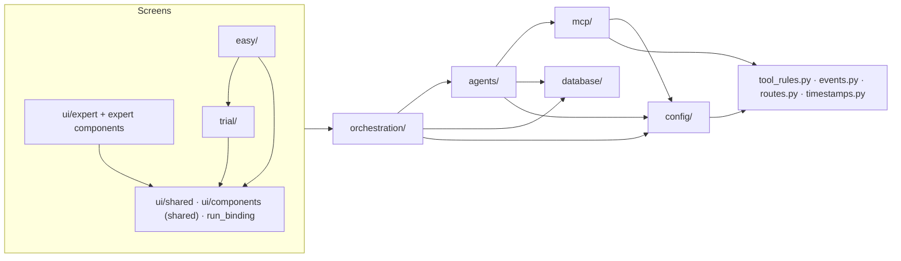
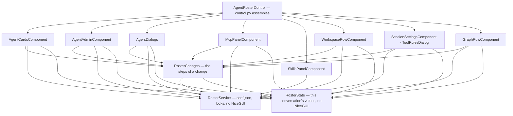

# Module Boundaries

Which part of `app/` may import which. The rules are not a convention to remember — they are checked on
every test run by [tests/test_layering.py](file:///d:/MultiAgentDebateOrchestration/tests/test_layering.py),
which reads every module's imports with `ast` (imports inside functions included, `TYPE_CHECKING` blocks
excluded) and fails on a new import that goes the wrong way.

---

## 1. Direction of Dependencies

| Package | May not import |
| :--- | :--- |
| `orchestration/` | any screen (`ui/`, `trial/`, `easy/`), `app.main`, NiceGUI |
| `agents/` | screens, `app.main`, `orchestration/`, NiceGUI |
| `mcp/` | screens, `app.main`, `orchestration/`, `agents/`, NiceGUI |
| `database/` | screens, `app.main`, `orchestration/`, `agents/`, `mcp/`, NiceGUI |
| `config/` | everything above it, NiceGUI |
| `tool_rules.py` | any other part of `app/` |

The debate never imports a screen. That is what lets a debate finish in the background after the browser
tab that started it is gone (see [Engine Lifecycle §4](file:///d:/MultiAgentDebateOrchestration/wiki/orchestration/engine-lifecycle.md)).

Small modules at the root of `app/` that everything may use carry no dependencies of their own:
`events.py` (event names), `routes.py` (page addresses), `timestamps.py` (time formatting),
`tool_rules.py` (the tool security rule grammar).

## 2. Inside the Orchestration Package

`engine.py` only assembles. The services (`recording`, `speech`, `conversation`, `turn_setup`, `context`)
and the phase executors (`phases/`) share one `EngineContext` and never import the engine or the runner.
Before this split the phase executors called back into the engine 111 times, and the engine delegated
straight back to them.

## 3. Screens

`app/ui/` holds two kinds of modules, and every module must be listed as one of them
(`test_every_ui_module_is_classified`):

- **Shared UI** — `ui/shared/`, `ui/run_binding.py`, the chat feed, the builder conversation
  (`ui/components/agent_builder_chat.py`), model status, appearance editor, markdown and clipboard helpers.
  They depend on no screen.
- **Expert UI** — `ui/expert/`, the roster panel, sidebar, artifact viewer, workspace download, access token,
  graph canvas, persona and graph pages.

| Screen | May not import |
| :--- | :--- |
| `trial/` | `easy/`, the expert UI |
| `easy/` | `trial/pages/` (it may use the trial site's login, gate and models), the expert UI |
| Shared UI | `trial/`, `easy/`, the expert UI |
| Expert UI | `trial/`, `easy/` |

## 4. Known Violations

`KNOWN_VIOLATIONS` in the test lists imports that were knowingly left in place. It is empty. An entry that
is fixed but left in the list also fails the test, so the list can only shrink.

## 5. Related Contract Tests

- [tests/test_public_surface.py](file:///d:/MultiAgentDebateOrchestration/tests/test_public_surface.py) — the
  names and signatures that code outside this repository relies on (the MADOWarGame driver subclasses
  `LLMCaller` and overrides `_complete_unthrottled`, swaps `engine.llm_caller`, opens `engine.session_factory`).
  They change only together with that driver.
- [tests/test_events.py](file:///d:/MultiAgentDebateOrchestration/tests/test_events.py) — event names are
  written only as `EventType` members, every member is sent somewhere, and the snapshot reducers handle only
  known events.

## 6. Decisions from the v1.4.1 Restructuring

The plan and its measurements are in `docs/refactoring-plan.md`. This section keeps the decisions a
maintainer needs when changing the code.

### 6.1. Behaviour changes that came with it

Only two; everything else was moved without changing behaviour.

- An MCP server that cannot start offers no tools; it used to register stand-in tools that reported invented
  successes. → [Resilience & Errors §3](file:///d:/MultiAgentDebateOrchestration/wiki/mcp/error-handling-resilience.md)
- The PairSlide integration is gone (PairSlide is discontinued). The guard that refuses writing `.pptx`,
  `.xlsx`, `.docx`, `.pdf` … with a text-writing tool stays: it prevents broken files and false "created"
  reports without PairSlide. → [Release Notes v1.4.1](file:///d:/MultiAgentDebateOrchestration/wiki/release-notes.md)

### 6.2. Moved names are not re-exported

When a function or class moves, every import of it — test `patch` targets included — changes in the same
commit, and the old module does not re-export it. MADO has not been released, so there is no outside caller
to keep working. The exception is the names pinned by `tests/test_public_surface.py`: they are a public API
for the MADOWarGame driver and stay where they are. Revisit this rule when MADO starts being deployed.

### 6.3. No service container

The plan proposed gathering the process-wide `get_*()` objects into one `AppServices`. It was not done. Each
`get_*()` already creates and owns its object on first use, tests and the MADOWarGame driver call those
names, and a container would give each object a second owner. Instead `lifespan` fixes the start order in
one place and `app/main.py` describes it, including that the DB engine is bound to the address of its first
caller ([Overview §4.1](file:///d:/MultiAgentDebateOrchestration/wiki/architecture/overview.md)).

### 6.4. One class across several files (mixins)

`LLMCaller` ([agents/llm.py](file:///d:/MultiAgentDebateOrchestration/app/agents/llm.py)) is split by concern into mixins (`llm_request` ·
`llm_recovery` · `llm_tool_calls` · `llm_loop`), and the class stays one object. The MADOWarGame driver subclasses
it and overrides `_complete_unthrottled`, so that shape is part of the public surface. A mixin file cannot be read
or tested on its own, because it uses attributes that other files set. Put a new method in the file of its concern.

`AgentRosterControl` and `ChatFeed` used to be built the same way and were replaced by components: see 6.9.

### 6.5. Where shared pieces live

Each of these sits below every package that uses it, which is what removed the import cycles that had been
hidden by imports inside functions:

- **Event names** — `app/events.py`, not `orchestration/`: `agents/consultation.py` sends events too, and
  `agents/` may not import `orchestration/`.
- **Tool rule grammar** — `app/tool_rules.py`: `config/schema.py` checks the rules in `conf.json` when it
  loads, `mcp/policy.py` judges calls with them, and `config/` may not import `mcp/`.
- **Model connection classification** — `agents/connection.py`: used by `llm.py`, `llm_fallback.py`, the model
  status check and its dialog, which used to import each other.
- **Agent draft and plain-language catalog** — `agents/draft.py`, `agents/catalog.py`: the expert add-agent
  dialog and the beginner builder both use them, and neither screen may import the other. What belongs to the
  beginner pages alone (demo agent, example tasks, visitor limits, saving a visitor's agent) stays in `easy/`.
- **Roster rules** — `orchestration/roster_service.py`: the lowest layer that can see the runner, the MCP pool,
  the agent pool and the config, and one the layering test keeps free of NiceGUI.

### 6.6. Files left whole

- `export_mermaid.py` (1,618 lines, the only file over 1,000) converts Mermaid to StarUML and standalone HTML.
  It imports only the standard library and is used from one place, the artifact viewer.
- `mcp/policy.py` (952 lines) is a pure judgement module: everything it decides on comes in as arguments.
  Only the rule grammar moved out (6.5).
- `security.py` and `mermaid_lint.py` were under 1,000 lines and in no import cycle, so they were out of scope.

### 6.7. Planned but not done

The first two were decided against on 2026-10-24 and reversed on 2026-10-30, when the cost of keeping them
(6.4 as it then was) came up again ([ADR-032](../../lectures/05-adr/ADR-032-compose-roster-and-feed.md)).

| Plan item | State |
| :--- | :--- |
| Move the agent draft and catalog out of the screens (P4) | Done 2026-10-30. `agents/draft.py`, `agents/catalog.py`; the builder conversation is `ui/components/agent_builder_chat.py` and `FormBuilderChat` moved into the roster. The expert UI may no longer import `easy/`. |
| Move applying roster changes to `conf.json` and the lock rules into a service without NiceGUI (P5) | Done 2026-10-30. `orchestration/roster_service.py` (`RosterService`), tested with a temporary `conf.json` in `tests/test_roster_service.py`. |
| Make `agents/llm.py` an `agents/llm/` package (P6) | Done as sibling modules instead (`llm_request`, `llm_recovery`, `llm_tool_calls`, `llm_context`, `llm_budget`, `llm_tools`, `llm_types`, `llm_fingerprint`, `reasoning`, `connection`). Why this was chosen over a package was not recorded. As it stands, `LLMCaller` is still defined in `app/agents/llm.py`, the path the MADOWarGame driver imports, so nothing has to be re-exported. |

### 6.8. The two longest functions, split (2026-10-24)

After the restructuring, the two longest functions on the speaking path were still whole:
`_run_litellm_loop` (400 lines) and `SpeechRunner.speak` (383 lines, the old `engine._speak`). Both were
split into steps with behaviour unchanged.

- **Tool loop** — moved to `agents/llm_loop.py` (`ToolLoopMixin`) first, in a commit that only moves, so
  `llm.py` stays under 1,000 lines (974 → 460). Its eleven local variables became one `ToolLoop`, which is
  also the checkpoint format. Steps: [LLM Integration §2](file:///d:/MultiAgentDebateOrchestration/wiki/agents/llm-integration.md).
- **Speech** — `speak()` keeps its signature and reads as receive → record → publish. The closures that
  shared its local variables became two small classes: `_ChunkStream` (batching stream chunks) and `_Speech`
  (the speech's id, tool records, draft and the callbacks handed to the tool loop).
- **Unchanged for the MADOWarGame driver**: `LLMCaller` in `app/agents/llm.py`, `_complete_unthrottled`
  and `_emit_chunk` (checked by `tests/test_public_surface.py` and the driver's own tests).

How the absence of a behaviour change was checked:

1. **Branch tests first.** `tests/test_speech_edges.py` pins eight branches no test went through
   (a failing checkpoint, a widened context window, wrap-up at the context limit, a broken budget arbiter,
   trimmed-context events, a failing draft save, a failing post-process, a tool record saved with the
   speech). It was committed and passing before any code moved.
2. **Golden master.** Scripted scenarios — 21 for the loop, 19 for the speech — recorded everything that
   leaves each function: every message sent to the model, tool choice, chunks, callbacks, checkpoints,
   events, DB rows, the returned value or exception. The recordings after the move and after each split
   were byte-for-byte identical to the one before. Together with the test suite, these scenarios executed
   every statement of both functions before the split, and of every new step after it.
3. The full test suite and the MADOWarGame driver tests.

### 6.9. Roster and feed as components (2026-10-30)

The mixins of 6.4 shared one object's attributes, so no file could be read or tested alone, and a name imported
by several files had to be replaced in each of them. Both classes are now assembled from objects that take what
they need through their constructor.

| Roster piece | Holds |
| :--- | :--- |
| [state.py](file:///d:/MultiAgentDebateOrchestration/app/ui/components/roster/state.py) `RosterState` | This conversation's values and the rules over them: who is on the roster, selection, speaking order, active count. |
| [roster_service.py](file:///d:/MultiAgentDebateOrchestration/app/orchestration/roster_service.py) `RosterService` | The roster's only way out: named `conf.json` writes, applying them to the running app, re-reading the file, the lock rules. Results come back as `Notice`. |
| [changes.py](file:///d:/MultiAgentDebateOrchestration/app/ui/components/roster/changes.py) `RosterChanges` | The steps around a change on screen: check the lock, write, apply, notify, redraw. Whom to redraw is a constructor callback. |
| [control.py](file:///d:/MultiAgentDebateOrchestration/app/ui/components/roster/control.py) `AgentRosterControl` | Builds the components, connects them with callbacks and lays them out. The page reads values from `roster_control.state` and calls the few methods left on the control. |

`ChatFeed` ([feed.py](file:///d:/MultiAgentDebateOrchestration/app/ui/components/chat_feed/feed.py)) keeps the status bar, input bar, stop and abort,
and assembles `CardTimeline` (`cards.py`), `ApprovalCards` and `PlanApprovalCard` (`approvals.py`), `DecisionBar`
and `UnfinishedTurnBar` (`decisions.py`) and `MentionUpload` (`mentions.py`). Three screens use it, so its public
methods stay on `ChatFeed` and delegate to the pieces. `CardTimeline` owns the message column, so `alive` is its
answer.

Two rules hold this in place, both in `tests/test_layering.py`: components do not import each other (they may
import shared modules only, and the assembling file imports them all), and no class under `ui/components/` is a
mixin or has more than one base. To add something, put the value in `RosterState`, the outside call in
`RosterService`, and pass a callback from `control.py` if another component must react. Tests hand a component a
small stub service ([tests/test_roster_components.py](file:///d:/MultiAgentDebateOrchestration/tests/test_roster_components.py),
[tests/test_feed_components.py](file:///d:/MultiAgentDebateOrchestration/tests/test_feed_components.py)); patching a name happens in one module,
`roster_service`, so `tests/roster_patch.py` is gone.

How the absence of a behaviour change was checked:

1. **Golden master through the browser's view.** Before any code moved, a script drew the real panels, clicked
   buttons found by their text or icon and fired the same events a browser sends, then recorded everything visible
   from outside: the element tree the browser receives, `conf.json` after each step, notifications, navigation,
   JavaScript sent, callbacks and state. 34 roster scenarios (157 steps) and 16 feed scenarios (130 steps) reached
   about 95% of the statements of both packages. The recordings after the move were identical except for one prop:
   the MCP add button no longer carries `disable: false`, because a disable and enable around a synchronous write
   (invisible to the browser) was removed.
2. The full test suite, unchanged in what it asserts.
3. The real app in a browser with a temporary config, database and a fake LLM: selection, add-agent with the builder
   dialog, a full turn through plan approval to conclusion, the lock during it, reload, resync, graph strategy,
   and `/trial/easy/build`.
