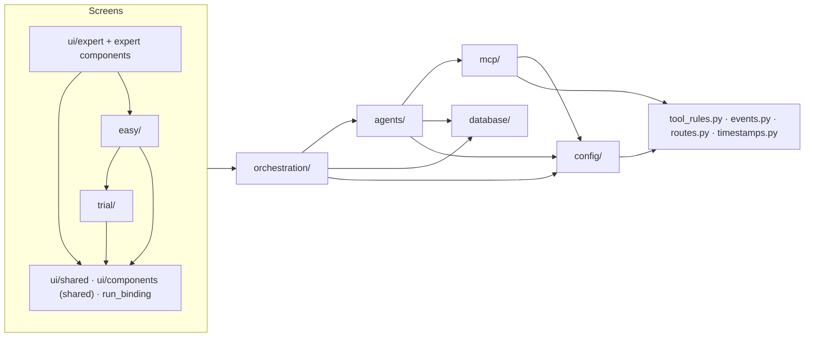

# Module Boundaries

Which part of `app/` may import which. The rules are not a convention to remember — they are checked on
every test run by [tests/test_layering.py](file:///d:/MultiAgentDebateOrchestration/tests/test_layering.py),
which reads every module's imports with `ast` (imports inside functions included, `TYPE_CHECKING` blocks
excluded) and fails on a new import that goes the wrong way.

---

## 1. Direction of Dependencies

| Package | May not import |
| :--- | :--- |
| `orchestration/` | any screen (`ui/`, `trial/`, `easy/`), `app.main`, NiceGUI |
| `agents/` | screens, `app.main`, `orchestration/`, NiceGUI |
| `mcp/` | screens, `app.main`, `orchestration/`, `agents/`, NiceGUI |
| `database/` | screens, `app.main`, `orchestration/`, `agents/`, `mcp/`, NiceGUI |
| `config/` | everything above it, NiceGUI |
| `tool_rules.py` | any other part of `app/` |

The debate never imports a screen. That is what lets a debate finish in the background after the browser
tab that started it is gone (see [Engine Lifecycle §4](file:///d:/MultiAgentDebateOrchestration/wiki/orchestration/engine-lifecycle.md)).

Small modules at the root of `app/` that everything may use carry no dependencies of their own:
`events.py` (event names), `routes.py` (page addresses), `timestamps.py` (time formatting),
`tool_rules.py` (the tool security rule grammar).

## 2. Inside the Orchestration Package

`engine.py` only assembles. The services (`recording`, `speech`, `conversation`, `turn_setup`, `context`)
and the phase executors (`phases/`) share one `EngineContext` and never import the engine or the runner.
Before this split the phase executors called back into the engine 111 times, and the engine delegated
straight back to them.

## 3. Screens

`app/ui/` holds two kinds of modules, and every module must be listed as one of them
(`test_every_ui_module_is_classified`):

- **Shared UI** — `ui/shared/`, `ui/run_binding.py`, the chat feed, model status, appearance editor,
  markdown and clipboard helpers. They depend on no screen.
- **Expert UI** — `ui/expert/`, the roster panel, sidebar, artifact viewer, workspace download, access token,
  graph canvas, persona and graph pages.

| Screen | May not import |
| :--- | :--- |
| `trial/` | `easy/`, the expert UI |
| `easy/` | `trial/pages/` (it may use the trial site's login, gate and models), the expert UI |
| Shared UI | `trial/`, `easy/`, the expert UI |
| Expert UI | `trial/` (it may reuse the beginner pages' agent builder) |

## 4. Known Violations

`KNOWN_VIOLATIONS` in the test lists imports that were knowingly left in place. It is empty. An entry that
is fixed but left in the list also fails the test, so the list can only shrink.

## 5. Related Contract Tests

- [tests/test_public_surface.py](file:///d:/MultiAgentDebateOrchestration/tests/test_public_surface.py) — the
  names and signatures that code outside this repository relies on (the MADOWarGame driver subclasses
  `LLMCaller` and overrides `_complete_unthrottled`, swaps `engine.llm_caller`, opens `engine.session_factory`).
  They change only together with that driver.
- [tests/test_events.py](file:///d:/MultiAgentDebateOrchestration/tests/test_events.py) — event names are
  written only as `EventType` members, every member is sent somewhere, and the snapshot reducers handle only
  known events.
