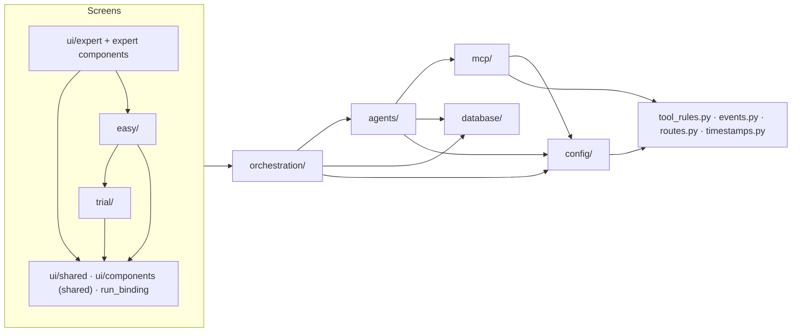

# Module Boundaries

Which part of `app/` may import which. The rules are not a convention to remember — they are checked on
every test run by [tests/test_layering.py](file:///d:/MultiAgentDebateOrchestration/tests/test_layering.py),
which reads every module's imports with `ast` (imports inside functions included, `TYPE_CHECKING` blocks
excluded) and fails on a new import that goes the wrong way.

---

## 1. Direction of Dependencies

| Package | May not import |
| :--- | :--- |
| `orchestration/` | any screen (`ui/`, `trial/`, `easy/`), `app.main`, NiceGUI |
| `agents/` | screens, `app.main`, `orchestration/`, NiceGUI |
| `mcp/` | screens, `app.main`, `orchestration/`, `agents/`, NiceGUI |
| `database/` | screens, `app.main`, `orchestration/`, `agents/`, `mcp/`, NiceGUI |
| `config/` | everything above it, NiceGUI |
| `tool_rules.py` | any other part of `app/` |

The debate never imports a screen. That is what lets a debate finish in the background after the browser
tab that started it is gone (see [Engine Lifecycle §4](file:///d:/MultiAgentDebateOrchestration/wiki/orchestration/engine-lifecycle.md)).

Small modules at the root of `app/` that everything may use carry no dependencies of their own:
`events.py` (event names), `routes.py` (page addresses), `timestamps.py` (time formatting),
`tool_rules.py` (the tool security rule grammar).

## 2. Inside the Orchestration Package

`engine.py` only assembles. The services (`recording`, `speech`, `conversation`, `turn_setup`, `context`)
and the phase executors (`phases/`) share one `EngineContext` and never import the engine or the runner.
Before this split the phase executors called back into the engine 111 times, and the engine delegated
straight back to them.

## 3. Screens

`app/ui/` holds two kinds of modules, and every module must be listed as one of them
(`test_every_ui_module_is_classified`):

- **Shared UI** — `ui/shared/`, `ui/run_binding.py`, the chat feed, model status, appearance editor,
  markdown and clipboard helpers. They depend on no screen.
- **Expert UI** — `ui/expert/`, the roster panel, sidebar, artifact viewer, workspace download, access token,
  graph canvas, persona and graph pages.

| Screen | May not import |
| :--- | :--- |
| `trial/` | `easy/`, the expert UI |
| `easy/` | `trial/pages/` (it may use the trial site's login, gate and models), the expert UI |
| Shared UI | `trial/`, `easy/`, the expert UI |
| Expert UI | `trial/` (it may reuse the beginner pages' agent builder) |

## 4. Known Violations

`KNOWN_VIOLATIONS` in the test lists imports that were knowingly left in place. It is empty. An entry that
is fixed but left in the list also fails the test, so the list can only shrink.

## 5. Related Contract Tests

- [tests/test_public_surface.py](file:///d:/MultiAgentDebateOrchestration/tests/test_public_surface.py) — the
  names and signatures that code outside this repository relies on (the MADOWarGame driver subclasses
  `LLMCaller` and overrides `_complete_unthrottled`, swaps `engine.llm_caller`, opens `engine.session_factory`).
  They change only together with that driver.
- [tests/test_events.py](file:///d:/MultiAgentDebateOrchestration/tests/test_events.py) — event names are
  written only as `EventType` members, every member is sent somewhere, and the snapshot reducers handle only
  known events.

## 6. Decisions from the v1.4.1 Restructuring

The plan and its measurements are in `docs/refactoring-plan.md`. This section keeps the decisions a
maintainer needs when changing the code.

### 6.1. Behaviour changes that came with it

Only two; everything else was moved without changing behaviour.

- An MCP server that cannot start offers no tools; it used to register stand-in tools that reported invented
  successes. → [Resilience & Errors §3](file:///d:/MultiAgentDebateOrchestration/wiki/mcp/error-handling-resilience.md)
- The PairSlide integration is gone (PairSlide is discontinued). The guard that refuses writing `.pptx`,
  `.xlsx`, `.docx`, `.pdf` … with a text-writing tool stays: it prevents broken files and false "created"
  reports without PairSlide. → [Release Notes v1.4.1](file:///d:/MultiAgentDebateOrchestration/wiki/release-notes.md)

### 6.2. Moved names are not re-exported

When a function or class moves, every import of it — test `patch` targets included — changes in the same
commit, and the old module does not re-export it. MADO has not been released, so there is no outside caller
to keep working. The exception is the names pinned by `tests/test_public_surface.py`: they are a public API
for the MADOWarGame driver and stay where they are. Revisit this rule when MADO starts being deployed.

### 6.3. No service container

The plan proposed gathering the process-wide `get_*()` objects into one `AppServices`. It was not done. Each
`get_*()` already creates and owns its object on first use, tests and the MADOWarGame driver call those
names, and a container would give each object a second owner. Instead `lifespan` fixes the start order in
one place and `app/main.py` describes it, including that the DB engine is bound to the address of its first
caller ([Overview §4.1](file:///d:/MultiAgentDebateOrchestration/wiki/architecture/overview.md)).

### 6.4. One class across several files (mixins)

Three large classes were split by concern into files of mixins, and the class itself stayed one object:

| Class | Defined in | Mixin files |
| :--- | :--- | :--- |
| `LLMCaller` | [agents/llm.py](file:///d:/MultiAgentDebateOrchestration/app/agents/llm.py) | `llm_request` · `llm_recovery` · `llm_tool_calls` |
| `AgentRosterControl` | [ui/components/roster/control.py](file:///d:/MultiAgentDebateOrchestration/app/ui/components/roster/control.py) | `session_settings` · `agent_cards` · `mcp_panel` · `agent_admin` · `agent_dialogs` · `skills_panel` · `graph_row` |
| `ChatFeed` | [ui/components/chat_feed/feed.py](file:///d:/MultiAgentDebateOrchestration/app/ui/components/chat_feed/feed.py) | `cards` · `approvals` · `decisions` · `mentions` |

Keeping one object meant every method still runs with the same attributes as before, so the split could not
change behaviour. The cost is that a mixin file cannot be read or tested on its own — it uses attributes that
other files set — and that a name imported by several mixin files must be replaced in each of them in tests
([tests/roster_patch.py](file:///d:/MultiAgentDebateOrchestration/tests/roster_patch.py) `patch_roster` does
this for the roster). Put a new method in the file of its concern. Logic that needs no NiceGUI is better
written as a plain function outside the class (see 6.7).

### 6.5. Where shared pieces live

Each of these sits below every package that uses it, which is what removed the import cycles that had been
hidden by imports inside functions:

- **Event names** — `app/events.py`, not `orchestration/`: `agents/consultation.py` sends events too, and
  `agents/` may not import `orchestration/`.
- **Tool rule grammar** — `app/tool_rules.py`: `config/schema.py` checks the rules in `conf.json` when it
  loads, `mcp/policy.py` judges calls with them, and `config/` may not import `mcp/`.
- **Model connection classification** — `agents/connection.py`: used by `llm.py`, `llm_fallback.py`, the model
  status check and its dialog, which used to import each other.

### 6.6. Files left whole

- `export_mermaid.py` (1,618 lines, the only file over 1,000) converts Mermaid to StarUML and standalone HTML.
  It imports only the standard library and is used from one place, the artifact viewer.
- `mcp/policy.py` (952 lines) is a pure judgement module: everything it decides on comes in as arguments.
  Only the rule grammar moved out (6.5).
- `security.py` and `mermaid_lint.py` were under 1,000 lines and in no import cycle, so they were out of scope.

### 6.7. Planned but not done

The first two were decided against on 2026-10-24; they are recorded here so they are not taken up again by
mistake.

| Plan item | State |
| :--- | :--- |
| Move the agent draft and catalog out of the screens (P4) | Not doing (decided 2026-10-24). The roster's `agent_admin.py` imports `easy.builder` (`AgentDraft`, `agent_key_for`), `easy.catalog` (`server_options`, `skill_options`) and `easy.pages.build` (`FormBuilderChat`); the layering test allows the expert UI this. `FormBuilderChat` is itself a screen component; the draft and catalog would have been the pieces to move. |
| Move applying roster changes to `conf.json` and the lock rules into a service without NiceGUI (P5) | Not doing (decided 2026-10-24). They are still methods of `AgentRosterControl`, and `test_agent_admin.py` and `test_roster_lock.py` still replace `ui.notify`. |
| Make `agents/llm.py` an `agents/llm/` package (P6) | Done as sibling modules instead (`llm_request`, `llm_recovery`, `llm_tool_calls`, `llm_context`, `llm_budget`, `llm_tools`, `llm_types`, `llm_fingerprint`, `reasoning`, `connection`). Why this was chosen over a package was not recorded. As it stands, `LLMCaller` is still defined in `app/agents/llm.py`, the path the MADOWarGame driver imports, so nothing has to be re-exported. |
