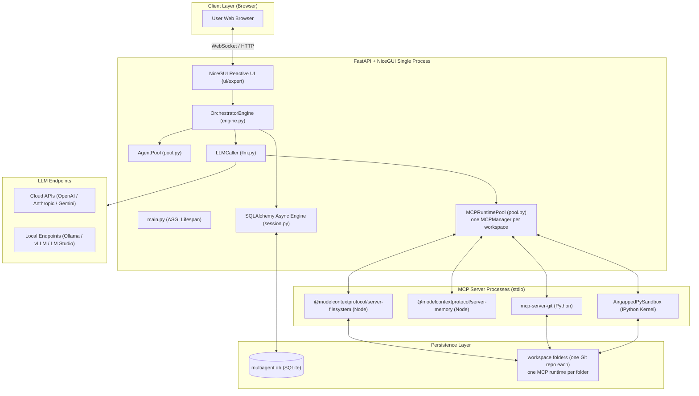
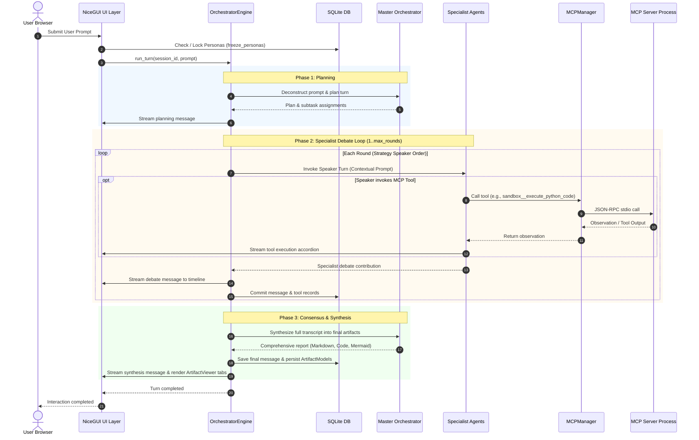

# Architecture Overview

This document describes the high-level architecture, technology stack, component decomposition, and execution flow of the **MADO: Multi-Agent Debate & Orchestration Platform**.

---

## 1. Architectural Philosophy

The MADO: Multi-Agent Debate & Orchestration Platform is designed around five foundational principles:

1. **Python-Native Full-Stack Unification**: The application combines backend logic ([FastAPI](file:///d:/MultiAgentDebateOrchestration/app/main.py)) and frontend reactive rendering ([NiceGUI](file:///d:/MultiAgentDebateOrchestration/app/ui/expert/page.py)) in a single Python runtime. This eliminates separate Node.js frontend build steps, transpilation, or split deployments.
2. **Dynamic Declarative Configuration**: Everything from model endpoints and API keys to individual agent personas and MCP tool access permissions is governed by [conf.json](file:///d:/MultiAgentDebateOrchestration/conf.json). The application never requires code changes to switch models, tune temperatures, or register new agent roles.
3. **Decoupled Tool Protocol (MCP)**: Instead of proprietary tool implementations, the system integrates the open **Model Context Protocol (MCP)**. Tool execution runs in isolated background processes (Node.js or Python) communicating via standard JSON-RPC over `stdio`.
4. **Resilient Multi-Provider LLM Abstraction**: Powered by [LiteLLM](file:///d:/MultiAgentDebateOrchestration/app/agents/llm.py), agents can utilize OpenAI, Anthropic, Google Gemini, Azure OpenAI, Ollama, LM Studio, or vLLM endpoints interchangeably. An agent whose endpoint cannot be reached is recorded as unreachable; no answer is invented in its place.
5. **Stateful Conversation & Persona Immutability**: While agent configurations are globally defined, each session allows independent persona customization. Once debate commences, personas are locked into the database ([SessionAgentModel](file:///d:/MultiAgentDebateOrchestration/app/database/models.py#L94-L115)) to guarantee consistent reasoning across multiple rounds and later sessions.

---

## 2. Technology Stack

| Layer | Component | Description & Rationale |
| :--- | :--- | :--- |
| **Runtime** | Python 3.11+ | Modern async/await, task groups, and strong typing. |
| **Server & API** | FastAPI + Uvicorn | High-performance asynchronous ASGI web server handling REST endpoints and application lifespan. |
| **Reactive Web UI** | NiceGUI (Vue / Quasar) | Python-based reactive UI engine using WebSocket connections for live message streaming and UI bindings. |
| **LLM Provider Gateway** | LiteLLM | Unified abstraction over 100+ LLM providers, parameter normalization, and function-calling schemas. |
| **Tool Protocol** | MCP Python SDK (`mcp`) | Host/client implementation managing `stdio` JSON-RPC communication with local and external MCP servers. |
| **Database & ORM** | SQLAlchemy (Async) + aiosqlite | Asynchronous SQLite ORM for persisting sessions, messages, tool traces, artifacts, and persona snapshots. |
| **Configuration** | Pydantic v2 + stdlib `json` | Strictly validated data classes with dynamic environment variable resolution (`${VAR:-default}`). A JSON config needs no third-party reader *or* writer, so the UI can safely write settings back. |

---

## 3. High-Level System Architecture

---

## 4. Subsystem Decomposition

### 4.1. Entrypoint & Lifecycle ([app/main.py](file:///d:/MultiAgentDebateOrchestration/app/main.py), [app/api.py](file:///d:/MultiAgentDebateOrchestration/app/api.py))
- `app/main.py` only assembles: the FastAPI server, its `lifespan`, the HTTP router, the NiceGUI pages, the trial and beginner pages, and the access middleware.
- `lifespan` fixes the start order in one place: configuration (`get_config()`) → database (`init_db()`, then interrupted turns are marked) → the default workspace's MCP runtime (`MCPRuntimePool.warm_default()`) → the agent pool. Other workspaces get their own server group when a debate first needs them (see [Runtime Isolation](file:///d:/MultiAgentDebateOrchestration/wiki/mcp/runtime-isolation.md)).
- Process-wide objects (config, DB engine, runtime pool, agent pool, engine, runner) are created by their own `get_*()` on first use. The DB engine is bound to the address of its **first** caller, so a script that drives the app from outside calls `get_config(config_path=…)` and `init_db(…)` before anything else.
- `app/api.py` holds the HTTP endpoints (`/api/health`, `/api/agents`, `/api/mcp`, `/api/skills`, `/api/sessions/{session_id}/personas`, `/api/diagnostics/client`, `/agent-icon`) and, since v1.5, the headless debate endpoints `/api/sessions/...`.
- `app/mcp_server.py` (v1.5) mounts MADO itself as an MCP server at `/mcp`; its session manager runs inside `lifespan`. Both doors share [`app/headless.py`](file:///d:/MultiAgentDebateOrchestration/app/headless.py) — see [Headless API](../operations/headless-api.md).
- On shutdown it cancels running debates first, then closes every runtime's MCP subprocesses.

### 4.2. Configuration Subsystem ([app/config/](file:///d:/MultiAgentDebateOrchestration/app/config/__init__.py))
- `env.py` — reads `.env` (and defaults `PYTHON_BIN`) the moment the package is imported; replaces `${VAR}`, `${VAR:-default}` and nested `${VAR:-${FALLBACK:-default}}`.
- `paths.py` — project root, data folder, workspace (always absolute), agent icon store.
- `schema.py` — the Pydantic models (`RootConfig`, `AppConfig`, `LLMConfig`, `AgentConfig`, `MCPServerConfig`, …) and their defaults; binds global `llm` settings onto agents unless overridden.
- `loader.py` — reads and writes `conf.json` with the standard-library `json` module, strips `//` documentation keys, owns the `get_config()` singleton.
- `editors.py` — the writers the roster panel uses (add/remove/order agents, MCP servers, skills, tool security rules). They validate before touching the file.
- The package's `__init__` lists the public names; the rest of the app imports from `app.config`.
- The tool security rule grammar (`read(path)`, `net(host)`, …) lives in [app/tool_rules.py](file:///d:/MultiAgentDebateOrchestration/app/tool_rules.py) so that configuration validation and the policy share it without importing each other.

### 4.3. Persistence Subsystem ([app/database/](file:///d:/MultiAgentDebateOrchestration/app/database/))
- Defined in [models.py](file:///d:/MultiAgentDebateOrchestration/app/database/models.py) and [session.py](file:///d:/MultiAgentDebateOrchestration/app/database/session.py).
- Uses `SQLAlchemy` async declarative base with `aiosqlite`.
- Stores complete conversation history, tool invocation parameters and outputs, extracted artifacts, and locked agent personas.

### 4.4. Agent & LLM Layer ([app/agents/](file:///d:/MultiAgentDebateOrchestration/app/agents/))
- **Base Agent Model** ([base.py](file:///d:/MultiAgentDebateOrchestration/app/agents/base.py)): runtime metadata, card colours and icons, connection modes (live vs. unconfigured).
- **Agent Pool Registry** ([pool.py](file:///d:/MultiAgentDebateOrchestration/app/agents/pool.py)): active agent instances loaded from configuration.
- **Session Personas** ([personas.py](file:///d:/MultiAgentDebateOrchestration/app/agents/personas.py)): session-specific overrides and the freeze/lock mechanism.
- **LLM Caller** ([llm.py](file:///d:/MultiAgentDebateOrchestration/app/agents/llm.py)): wraps LiteLLM `acompletion` and runs the tool loop up to `max_tool_iterations`. An unreachable endpoint raises `LLMUnavailableError` ([llm_types.py](file:///d:/MultiAgentDebateOrchestration/app/agents/llm_types.py)); nothing is fabricated in its place. Its side concerns sit next to it: the tool loop (`llm_loop.py`), building the request (`llm_request.py`), recovering cut or empty answers (`llm_recovery.py`), handling one tool call (`llm_tool_calls.py`), fitting the context window (`llm_context.py`), limit notices (`llm_budget.py`), tool-name lookup and file-writing and file-editing guidance (`llm_tools.py`), reasoning traces (`reasoning.py`), request fingerprints (`llm_fingerprint.py`).
- **Connections** ([connection.py](file:///d:/MultiAgentDebateOrchestration/app/agents/connection.py)): which agents share a model connection, and how a LiteLLM error is classified. Used by the connection status dialog (`model_status.py`) and the global-model fallback (`llm_fallback.py`).

### 4.5. Model Context Protocol (MCP) Host ([app/mcp/](file:///d:/MultiAgentDebateOrchestration/app/mcp/))
- Implements an asynchronous MCP host manager ([manager.py](file:///d:/MultiAgentDebateOrchestration/app/mcp/manager.py)) and stdio client connection manager ([client.py](file:///d:/MultiAgentDebateOrchestration/app/mcp/client.py)).
- Holds **one manager per workspace** in a reference-counted pool ([pool.py](file:///d:/MultiAgentDebateOrchestration/app/mcp/pool.py)), because a server binds the folder it may touch at spawn time. This is what lets debates in different workspaces run concurrently.
- Manages long-lived client processes so stateful tools (e.g., IPython kernel namespaces, memory graph) persist across debate turns.
- Auto-converts MCP tool schemas into OpenAI Function Calling format with namespaced qualified names (`server__tool`).
- Captures raw process stderr using a dedicated background thread tee for accurate diagnostic tooltips in the UI.
- A server that cannot start offers no tools, and a call to a server that cannot be reached returns an error observation — nothing is simulated.

### 4.6. Multi-Agent Orchestration Engine ([app/orchestration/](file:///d:/MultiAgentDebateOrchestration/app/orchestration/))
- [engine.py](file:///d:/MultiAgentDebateOrchestration/app/orchestration/engine.py) assembles the pieces and owns a turn's life: `run_turn()` / `resume_turn()` borrow the workspace's MCP runtime, record the turn, and run the three phases.
- The pieces share one [`EngineContext`](file:///d:/MultiAgentDebateOrchestration/app/orchestration/context.py) (agent pool, swappable `llm_caller`, DB session factory, tool gates) and never call back into the engine:
  - [recording.py](file:///d:/MultiAgentDebateOrchestration/app/orchestration/recording.py) — `TurnRecorder`: messages, notes, tool records, turn state; retries and the `data/unsaved/` fallback.
  - [speech.py](file:///d:/MultiAgentDebateOrchestration/app/orchestration/speech.py) — `SpeechRunner`: one agent's speech, streamed and recorded; the limit prompts (tool budget, context window). `speak()` runs it in steps — receive (`_receive_speech`), record (`_record_speech`), publish (`_publish_speech`) — with the speech's own state (chunk batching, tool records, draft) in `_Speech` and `_ChunkStream`.
  - [conversation.py](file:///d:/MultiAgentDebateOrchestration/app/orchestration/conversation.py) — `ConversationMemory`: the speaker's context, folding into the summary, the decision ledger.
  - [turn_setup.py](file:///d:/MultiAgentDebateOrchestration/app/orchestration/turn_setup.py) — `TurnPreparer`: configuration and participants of a turn, the tool gate.
- Phase executors in [phases/](file:///d:/MultiAgentDebateOrchestration/app/orchestration/phases/):
  1. **Planning** (`planning.py`): the orchestrator analyzes the goal; the plan can be approved or revised by a person.
  2. **Specialist Debate** (`debate.py`, with `parallel.py` for parallel dispatch, `graph.py` for graph debates, `routing.py` for reading the orchestrator's speaker and task choices): order comes from each agent's `debate_priority`; the adversarial strategy pairs them by `debate_stance`.
  3. **Consensus & Synthesis** (`synthesis.py`): the orchestrator synthesizes the transcript into final artifacts.
  - Outside a turn's phases, `retry.py` rebuilds the moment before one finished speech and takes a new version of it ([speech_retry.py](file:///d:/MultiAgentDebateOrchestration/app/orchestration/speech_retry.py), [Retrying One Speech](../orchestration/speech-revisions.md)).
- [turn_run.py](file:///d:/MultiAgentDebateOrchestration/app/orchestration/turn_run.py) keeps the canonical snapshot of a running turn (one reducer per event); [runner.py](file:///d:/MultiAgentDebateOrchestration/app/orchestration/runner.py) starts and ends turns in the background. Event names are listed once in [app/events.py](file:///d:/MultiAgentDebateOrchestration/app/events.py).

### 4.7. User Interface Subsystem ([app/ui/](file:///d:/MultiAgentDebateOrchestration/app/ui/))
- Built with NiceGUI on Quasar/Vue components; real-time updates over WebSockets without page reloads.
- The expert page lives in [ui/expert/](file:///d:/MultiAgentDebateOrchestration/app/ui/expert/page.py): `page.py` (`ExpertPage`), `events.py` (one handler per debate event), `chrome.py` (header and about dialog).
- Every screen (expert, trial, beginner) attaches to a running debate through [`RunBinding`](file:///d:/MultiAgentDebateOrchestration/app/ui/run_binding.py); closing the page drops the subscription, never the debate.
- Components:
  - [SessionSidebar](file:///d:/MultiAgentDebateOrchestration/app/ui/components/sidebar.py): session history, creation, and deletion.
  - [AgentRosterControl](file:///d:/MultiAgentDebateOrchestration/app/ui/components/roster/control.py): assembles the components in `roster/` (session settings, workspace row, agent cards, MCP panel, agent administration, per-card dialogs, skills panel, graph row) over a shared `RosterState`, `RosterService` and `RosterChanges` ([Module Boundaries §6.9](module-boundaries.md)).
  - [ChatFeed](file:///d:/MultiAgentDebateOrchestration/app/ui/components/chat_feed/feed.py): assembles the pieces in `chat_feed/` (card timeline, approval cards, decision bars, mentions) behind one public surface.
  - [ArtifactViewer](file:///d:/MultiAgentDebateOrchestration/app/ui/components/artifact_viewer.py): multi-tab viewer with syntax highlighting and Mermaid diagram rendering.
  - [PersonasPage](file:///d:/MultiAgentDebateOrchestration/app/ui/personas_page.py): session persona configuration editor.
- Trial and beginner pages share the visitor-page frame in [ui/shared/page.py](file:///d:/MultiAgentDebateOrchestration/app/ui/shared/page.py); page addresses are in [app/routes.py](file:///d:/MultiAgentDebateOrchestration/app/routes.py).

### 4.7-b. v1.5 modules
| Module | Role |
| :--- | :--- |
| `app/agents/llm_usage.py` | Token and LLM-time meters per speech and turn ([LLM Integration §6](../agents/llm-integration.md)) |
| `app/agents/ask_user.py` | `ask__ask_user` host tool ([Ask the User](../agents/ask-user.md)) |
| `app/workspace_checkpoint.py` | Turn snapshots in the workspace repository, revert, export ([Workspace Checkpoints](../orchestration/workspace-checkpoints.md)) |
| `app/database/search.py` | FTS5 trigram index and conversation search |
| `app/headless.py`, `app/mcp_server.py` | Debates without a page: REST and MCP ([Headless API](../operations/headless-api.md)) |
| `app/session_fork.py` | Forking a conversation at a turn, compare data, ratings ([Session Handoff §7](../orchestration/session-handoff.md)) |
| `app/orchestration/skill_draft.py` | Skill drafts from a turn ([Skills §10](../agents/skills.md)) |
| `app/orchestration/speech_comments.py` | Inline comments delivered to one agent's next speech, v1.5.1 ([Retrying One Speech §6](../orchestration/speech-revisions.md#6-inline-comments)) |
| `app/orchestration/ledger_edit.py` | A person's direct edit of the decision ledger, v1.5.1 ([Conversation Memory §4.1](../orchestration/context-memory.md#41-editing-it-directly)) |
| `app/bench.py` | Strategy comparison harness ([Bench](../operations/bench.md)) |
| `app/ui/compare_page.py`, `app/ui/components/turn_changes.py`, `app/ui/components/skill_draft_dialog.py` | Compare page and the conclusion card's dialogs |

### 4.8. Module Boundaries
Which package may import which is checked by a test. See [Module Boundaries](file:///d:/MultiAgentDebateOrchestration/wiki/architecture/module-boundaries.md), which also records the decisions of the v1.4.1 restructuring (§6).

---

## 5. End-to-End Request & Turn Lifecycle

